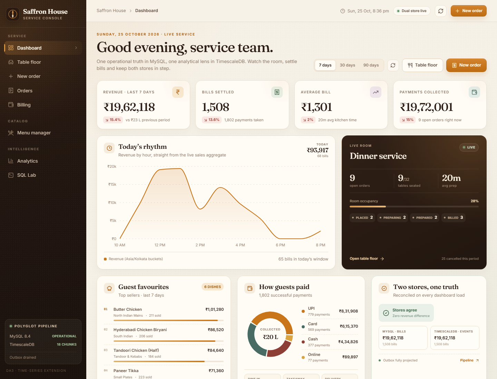
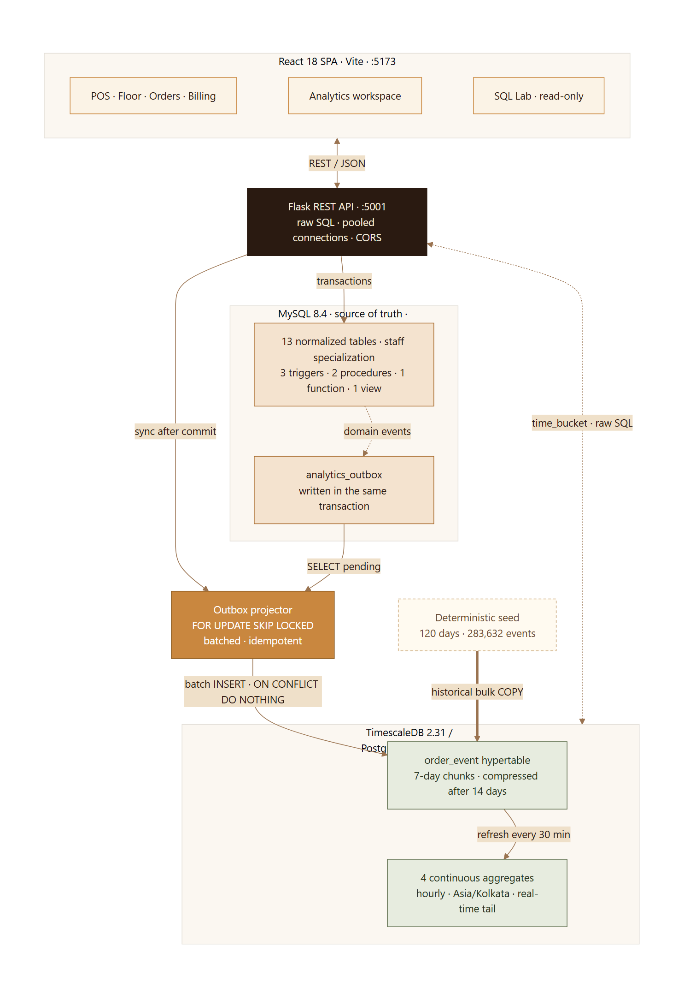

# Saffron House

**Restaurant Order & Billing System · DA3 time-series extension**

A complete restaurant POS and analytics application that keeps its operational truth in **MySQL 8.4** and mirrors every meaningful state change into **TimescaleDB 2.31 / PostgreSQL 17** for time-series analysis. A transactional outbox connects the two stores without distributed transactions.



## What it demonstrates

- **Polyglot persistence with a clear split of responsibility** — normalized OLTP data in MySQL; a denormalized, append-only event stream in a TimescaleDB hypertable.
- **Transactional outbox + idempotent projector** — the POS write and its analytics event commit atomically in MySQL; `FOR UPDATE SKIP LOCKED`, batched inserts and `ON CONFLICT DO NOTHING` make projection safe to retry.
- **Database programming inside MySQL** — EER specialization, 14 foreign keys, 3 triggers, 2 stored procedures, 1 function and 1 reporting view.
- **Native time-series features inside TimescaleDB** — 7-day chunks, 4 continuous aggregates aligned to Asia/Kolkata, real-time aggregation, post-drain refreshes for the touched hour, 30-minute refresh policies, columnar compression after 14 days and 730-day retention.
- **A real application, not a query demo** — React POS, floor plan, order lifecycle, split payments, receipts, analytics workspace, SQL Lab and a live benchmark screen.
- **Reconciled semantics** — revenue is recognised at `BILL_GENERATED`; money collected is recognised at `PAYMENT_RECEIVED`. Both stores return identical answers, verified at full-history and 90-day windows.

## Architecture



**Write path:** React → Flask → MySQL transaction (business rows + `analytics_outbox`) → commit → projector drains the outbox → TimescaleDB `order_event` → touched hourly buckets refreshed → dashboards read continuous aggregates.

**Read path:** dashboards and charts query the continuous aggregates; cross-store reconciliation reads the raw `order_event` stream instead, so its totals match MySQL exactly rather than sitting on a CAGG refresh boundary. SQL Lab can scan raw events or run relational MySQL queries. The analytics store needs no cross-database joins because dimension names are snapshotted onto each event.

The historical seed is the one intentional exception: it `COPY`-loads 283,634 generated events directly into TimescaleDB instead of replaying them through the outbox (see [Limitations](#honest-limitations)).

More diagrams: [outbox sequence](docs/diagrams/event-pipeline.png) · [order lifecycle](docs/diagrams/order-lifecycle.png) · [ER model](docs/diagrams/er-model.png).

## Stack

| Layer | Technology |
| --- | --- |
| Frontend | React 18.3, Vite 5, React Router 6, Recharts 2, Lucide icons, hand-written CSS |
| API | Python 3.12, Flask 3, raw SQL, pooled MySQL + PostgreSQL connections, CORS |
| Operational store | MySQL 8.4.13 — InnoDB, strict SQL mode, Asia/Kolkata session time zone |
| Analytics store | TimescaleDB 2.31.0 on PostgreSQL 17.11 |
| Packaging | Docker Compose for both databases; venv + npm for the app |
| Testing | pytest API suite + SQL integrity checks + production Vite build |

## Quick start

### 1. Prerequisites

- Docker Desktop (Linux containers)
- Python 3.12+
- Node.js 20+ and npm
- Git Bash, WSL, macOS or Linux shell. PowerShell equivalents are noted below.

### 2. Configure

```bash
cp .env.example .env
```

Defaults: MySQL on host port **3307**, TimescaleDB on **5433**, Flask on **5001**, Vite on **5173**. The credentials are development-only and live in a gitignored `.env`.

### 3. Start the databases

```bash
docker compose up -d
docker compose ps
```

Wait until both services report `healthy`.

### 4. Load both schemas

The seed script populates existing tables; it does not create schemas.

```bash
docker exec -i saffron-mysql mysql -urestaurant -prestaurantpass restaurant < database/mysql/01_schema.sql
docker exec -i saffron-timescale psql -U restaurant -d restaurant_analytics < database/timescale/01_schema.sql
```

<details>
<summary>PowerShell equivalents</summary>

```powershell
Get-Content -Raw database/mysql/01_schema.sql | docker exec -i saffron-mysql mysql -urestaurant -prestaurantpass restaurant
Get-Content -Raw database/timescale/01_schema.sql | docker exec -i saffron-timescale psql -U restaurant -d restaurant_analytics
```

</details>

### 5. Install the backend

```bash
python -m venv .venv
.venv/Scripts/python.exe -m pip install -r backend/requirements.txt
```

On macOS/Linux use `.venv/bin/python` instead of `.venv/Scripts/python.exe`.

### 6. Generate and load the sample data

```bash
.venv/Scripts/python.exe backend/scripts/seed.py
```

This is deterministic (`seed = 20261025`) and takes roughly 40 seconds on the reference laptop. It writes CSV snapshots under `data/sample/`, truncates the operational tables and the event CSV, reloads both stores, refreshes the continuous aggregates, compresses eligible chunks and writes `data/generated/seed_summary.json`.

### 7. Start the API

```bash
.venv/Scripts/python.exe backend/app.py
```

Flask listens on **http://127.0.0.1:5001**. Check it with:

```bash
curl http://127.0.0.1:5001/api/health
```

### 8. Start the frontend

```bash
cd frontend
npm install
npm run dev
```

Open **http://localhost:5173**. Vite proxies `/api` to Flask, so no frontend environment variable is required.

### 9. Run the checks (optional)

```bash
.venv/Scripts/python.exe -m pytest backend/tests -q
cd frontend && npm run build
```

## Deploy on a single free VM

`deploy/` runs the whole stack on one Ubuntu host — a free-tier cloud VM, a
home server or any small VPS. The current deployment runs on Azure for
Students (Standard_B2als_v2, 4 GiB, Ubuntu 24.04):

| Environment | URL |
| --- | --- |
| HTTPS (canonical) | https://85-211-182-145.sslip.io |
| Plain HTTP (VM IP) | http://85.211.182.145 |

| File | Purpose |
| --- | --- |
| `deploy/docker-compose.prod.yml` | MySQL, TimescaleDB, gunicorn API and Caddy, isolated under the `saffron-house-prod` project |
| `deploy/bootstrap.sh` | Installs Docker, opens 80/443, generates `deploy/.env` with random passwords, loads both schemas, seeds once and starts the site |
| `deploy/Caddyfile` | Serves the built SPA with deep-link fallback and proxies `/api/*` to Flask |

```bash
sudo bash -c "curl -fsSL https://raw.githubusercontent.com/TheNiranjanY/saffron-house-da3/main/deploy/bootstrap.sh | bash"
```

Open `http://<vm-ip>`. For automatic HTTPS, set `SITE_ADDRESS` in `deploy/.env`
to one or more Caddy site addresses — for example
`SITE_ADDRESS="pos.example.com, http://<vm-ip>"` keeps the bare IP working over
HTTP while Caddy obtains a certificate for the hostname:

```bash
sudo sed -i 's|^SITE_ADDRESS=.*|SITE_ADDRESS="pos.example.com, http://<vm-ip>"|' deploy/.env
sudo docker compose -f deploy/docker-compose.prod.yml --env-file deploy/.env up -d
```

The script is idempotent: schema loading and the seed are guarded by
`deploy/.seeded`, and database credentials never leave the host's gitignored
env file.

## What you can do

| Area | Capability |
| --- | --- |
| **Dashboard** | Seven-day KPIs, hourly revenue, live room occupancy, top sellers, payment mix, cross-store reconciliation, recent event stream |
| **Table floor** | 32 tables across four sections; free/occupied state derived from open orders and database triggers |
| **New order (POS)** | Choose a free table, waiter, guest and dishes; assign a chef to each line; create a walk-in guest inline; prices snapshot at order time |
| **Orders** | Filter by scope/status/type, search, open a ticket, add lines, advance `PREPARING → PREPARED`, cancel eligible orders, follow the event timeline |
| **Billing** | Generate a bill with tax and optional discount, list outstanding bills, take split payments (`CASH`, `CARD`, `UPI`, `ONLINE`), print a receipt |
| **Menu manager** | Browse 8 categories / 48 dishes, toggle availability, add items and categories, inspect specials |
| **Analytics** | Revenue, menu & flow, kitchen, payments and data-platform tabs over 7/30/90-day restaurant-local windows |
| **Data platform** | Hypertable footprint, compressed chunks, continuous aggregate inventory, outbox health, live MySQL vs TimescaleDB benchmark |
| **SQL Lab** | 15 curated read-only queries across both databases, editable SQL, 500-row result cap, server-side write rejection |

## Data model

### MySQL — source of truth

13 tables, 14 foreign keys, 3 triggers, 2 procedures, 1 function, 1 view.

| Group | Tables |
| --- | --- |
| Staff EER specialization | `staff` → `waiter` / `chef` / `cashier` (shared primary keys) |
| Dimensions | `customer`, `dining_table`, `menu_category`, `menu_item` |
| Transactional core | `orders`, `bill`, `order_item`, `payment` |
| Integration | `analytics_outbox` |

Design details:

- `order_item` uses a composite key `(order_id, line_no)`, snapshots `price_at_order`, and deliberately carries `bill_id` — the one intentional denormalization inherited from DA2. A SQL Lab audit proves it never disagrees with `bill`.
- `bill.order_id` is unique (one bill per order); `payment` supports many rows per bill, enabling partial and split settlement.
- Constraints enforce positive quantities and payments, a table for every `DINE_IN` order, valid capacity, one cashier per counter, and legal totals.
- Triggers: `trg_orders_ai_status` / `trg_orders_au_status` keep `dining_table.status` in step with the order lifecycle; `trg_payment_ai_bill` recalculates `bill.payment_status` and closes the order when successful payments reach the grand total.
- Routines: `add_order_item` validates order state, menu availability and line numbering; `generate_bill` computes tax/discount/total, writes the bill and marks billed lines; `calc_grand_total` and the `DailySalesSummary` view provide the relational reporting baseline.

### TimescaleDB — analytics read model

One denormalized event table, one hypertable, six secondary indexes.

`order_event` snapshots everything a chart needs: event time/type, order, table, customer, waiter, chef, item, category, quantity, amount, payment mode, bill, payment and preparation seconds. Dimension names are captured at write time, so renaming a menu item later does not rewrite history and analytics never joins back into MySQL.

| Event | Meaning | Amount semantics |
| --- | --- | --- |
| `ORDER_PLACED` | A ticket entered the kitchen | — |
| `ITEM_ADDED` | One order line | line value |
| `ORDER_PREPARING` | Kitchen started | — |
| `ORDER_PREPARED` | Kitchen finished | — |
| `BILL_GENERATED` | Bill issued | bill grand total (revenue) |
| `PAYMENT_RECEIVED` | One successful payment | payment amount (collections) |
| `ORDER_CLOSED` | Fully settled and table released | — |
| `ORDER_CANCELLED` | Ticket cancelled before billing | — |

Four continuous aggregates (`sales_hourly`, `order_activity_hourly`, `payments_hourly`, `kitchen_performance_hourly`) roll the stream into Kolkata-aligned hourly buckets. `materialized_only = false` serves the current, not-yet-materialized hour from raw events, so live orders appear immediately.

## Technology-specific SQL

**Transactional outbox in the same commit** (`backend/restaurant/order_service.py`, `backend/restaurant/events.py`): business rows and JSON event rows share one MySQL transaction; the API responds only after commit.

**Projection batch** (`backend/restaurant/events.py`):

```sql
SELECT outbox_id, event_time, event_type, payload
  FROM analytics_outbox
 WHERE processed_at IS NULL
 ORDER BY outbox_id
 LIMIT %s
 FOR UPDATE SKIP LOCKED
```

**Gap-filled hourly revenue** (`backend/restaurant/sql_catalog.py`):

```sql
SELECT time_bucket_gapfill('1 hour', event_time, 'Asia/Kolkata') AS bucket,
       COALESCE(SUM(amount) FILTER (WHERE event_type = 'BILL_GENERATED'), 0) AS revenue,
       COUNT(*) FILTER (WHERE event_type = 'BILL_GENERATED') AS bills
  FROM order_event
 WHERE event_time >= now() - INTERVAL '48 hours'
   AND event_time < now()
 GROUP BY bucket
 ORDER BY bucket;
```

**Kitchen percentiles** — p50 and p95 preparation seconds per day using `percentile_cont(...) WITHIN GROUP`.

**Continuous aggregate query** — dashboards read `sales_hourly` with `time_bucket(...)` and local-day filters instead of scanning the hypertable.

**Lifecycle management**:

```sql
SELECT add_compression_policy('order_event', INTERVAL '14 days');
SELECT add_retention_policy('order_event', INTERVAL '730 days');
```

SQL Lab exposes all of these as 15 presets, including rolling averages, peak-hour heatmaps, waiter snapshots, payment pivots, the order funnel, compression audit, outbox health and the intentional-denormalization audit.

## API overview

All responses are JSON. Errors use `{ "error": { "message": ... } }`; MySQL `SIGNAL` errors surface as HTTP 400, duplicate keys as 409, locked rows as 409, and an unavailable analytics store as 503.

| Group | Endpoints |
| --- | --- |
| System | `GET /api/health` · `POST /api/system/sync` |
| Floor & people | `GET /api/tables` · `GET /api/staff` · `GET/POST /api/customers` |
| Menu | `GET/POST /api/menu` · `GET /api/menu/specials` · `POST /api/menu/categories` · `PATCH /api/menu/items/{id}` |
| Orders | `GET/POST /api/orders` · `GET /api/orders/{id}` · `POST /api/orders/{id}/items` · `POST /api/orders/{id}/status` |
| Billing | `GET /api/bills` · `GET /api/bills/outstanding` · `GET /api/bills/{id}` · `POST /api/orders/{id}/bill` · `POST /api/bills/{id}/payments` |
| Analytics | `GET /api/analytics/dashboard` · `/revenue-series` · `/peak-hours` · `/top-items` · `/kitchen` · `/payments` · `/order-flow` · `/storage` |
| SQL Lab / benchmark | `GET/POST /api/analytics/sql` · `POST /api/analytics/benchmark` |

## Repository map

```text
backend/
  app.py                     Flask entry point
  restaurant/
    api/                     Blueprints: system, dining, catalog, orders, billing, analytics
    order_service.py         Transactional POS operations + event emission
    events.py                Outbox writer, projector, reconciliation status
    benchmark.py             Interleaved MySQL/Timescale comparison + reconciliation
    sql_catalog.py           15 curated SQL Lab presets
    db.py                    Pooled MySQL and TimescaleDB connections
    config.py                Environment configuration
  scripts/seed.py            Deterministic 120-day data generator and loader
  tests/
    test_api.py              Core API, SQL Lab guard, reconciliation and lifecycle tests
    test_order_rules.py      Order/POS and billing rule enforcement (state machine, math, payments)
    test_catalog_and_customers.py  Menu, category and guest-directory CRUD and validation
    test_analytics_api.py    SQL Lab, dashboard, reconciliation, KPI payloads and window guards
    test_queries_and_system.py  Health, outbox idempotency, list filters and pagination clamps
    test_timeutil.py         Kolkata time zone helpers and date boundaries
database/
  mysql/01_schema.sql        Tables, constraints, triggers, routines, view
  timescale/01_schema.sql    Hypertable, indexes, continuous aggregates, policies
frontend/                    React SPA (POS, billing, analytics, SQL Lab)
docs/
  diagrams/                  Mermaid sources + rendered SVG/PNG
screenshots/                 Desktop, mobile and end-to-end evidence
data/
  sample/                    CSV snapshots for inspection
  generated/                 Seed + benchmark evidence (gitignored)
```

## Benchmark

Measured with both databases in Docker on the same laptop, warm runs, **30 interleaved samples per store** (3 API runs × 10 iterations; the store order reverses every round). Windows are Kolkata calendar-day aligned so both stores see exactly the same 90 days: **212,484 events, 22,085 bills, ₹28,783,764.50 revenue, difference ₹0.00**.

| Scenario (rows returned) | MySQL | Timescale raw | Timescale CAGG | Speed-up |
| --- | ---: | ---: | ---: | ---: |
| 90-day daily revenue (90) | 30.00 ms | 26.42 ms | **5.58 ms** | CAGG **5.38×**, raw 1.14× |
| 7-day hourly revenue (92) | 19.35 ms | — | **4.30 ms** | CAGG **4.50×** |
| Top 10 menu items (10) | 152.55 ms | **27.25 ms** | — | raw **5.60×** |

Interquartile ranges (p25–p75): daily 24.11–35.14 / 22.34–36.13 / 4.19–6.89 ms; hourly 12.41–21.92 / 3.30–5.10 ms; top items 146.52–185.89 / 25.19–29.52 ms.

**Read this honestly.** The continuous aggregates win because the work is precomputed. The raw-vs-MySQL daily comparison is only 1.14×: MySQL scans ~22k indexed bills while TimescaleDB scans a deliberately wider 212k-event table, so the engines are close for this shape. Top items is 5.6× faster because the event store answers from one denormalized table without the menu/order/bill joins. Absolute browser-run timings vary with host load; the canonical numbers above come from the interleaved API runs in `data/generated/benchmark-summary.json`, not from the screenshot.

## Verification summary

- **Seed:** 29,831 orders · 100,180 order items · 29,465 bills · 35,400 payments · 283,634 events · 39.4 s total load.
- **MySQL integrity:** zero bill-math mismatches, zero orphan items/payments, zero paid-but-open orders, zero closed-but-unpaid orders, zero missing/mismatched `bill_id`; `calc_grand_total` matched stored totals.
- **TimescaleDB:** 18 chunks, 15 compressed, 92.3% storage saved (12.9×), 4 continuous aggregates and 4 refresh policies active.
- **Reconciliation:** full-history sales (29,465 bills, ₹38,421,396.00) and successful collections (35,400 payments, ₹38,420,133.01) match MySQL exactly; the ₹1,262.99 gap between billed revenue and collections is the open balance on 3 partial bills.
- **SQL Lab:** all 15 presets execute; writes are rejected before execution.
- **Tests/build:** 28-test pytest suite passes (rules, catalog, analytics, pagination, time zone), and the Vite production build succeeds.

These figures are from the 25 October 2026 seed run used in the report. The generator anchors its 120-day window to the current date, so a later reseed adds service days and shifts the absolute totals; the invariants, percentages and zero-difference reconciliation still hold.

## Diagrams

- [ER model](docs/diagrams/er-model.png) · [event pipeline](docs/diagrams/event-pipeline.png) · [order lifecycle](docs/diagrams/order-lifecycle.png) · [architecture](docs/diagrams/architecture.png)

## Honest limitations

- The historical seed `COPY`-loads directly into TimescaleDB; only live POS traffic demonstrates the outbox end to end. Outbox metrics therefore start at zero after a reseed.
- This is a single-host Docker benchmark over 120 restaurant days (~284k events), intended to show relative shape, not production throughput. Results move with host load.
- Authentication, authorization, multi-tenancy, audit-on-edit, backups and high availability are outside the academic scope. SQL Lab is read-only through server-side statement checks, not database roles.
- Currency is INR and all reporting is fixed to the Asia/Kolkata restaurant calendar. Revenue excludes cancelled orders and is recognised at bill generation.
- Re-running the seed is destructive: it truncates the operational tables and the hypertable before reloading.

---

**DA3 · Database Systems mini-project extension** — MySQL was chosen as the relational operational store; TimescaleDB supplies the modern time-series capability without giving up SQL or ACID semantics.
