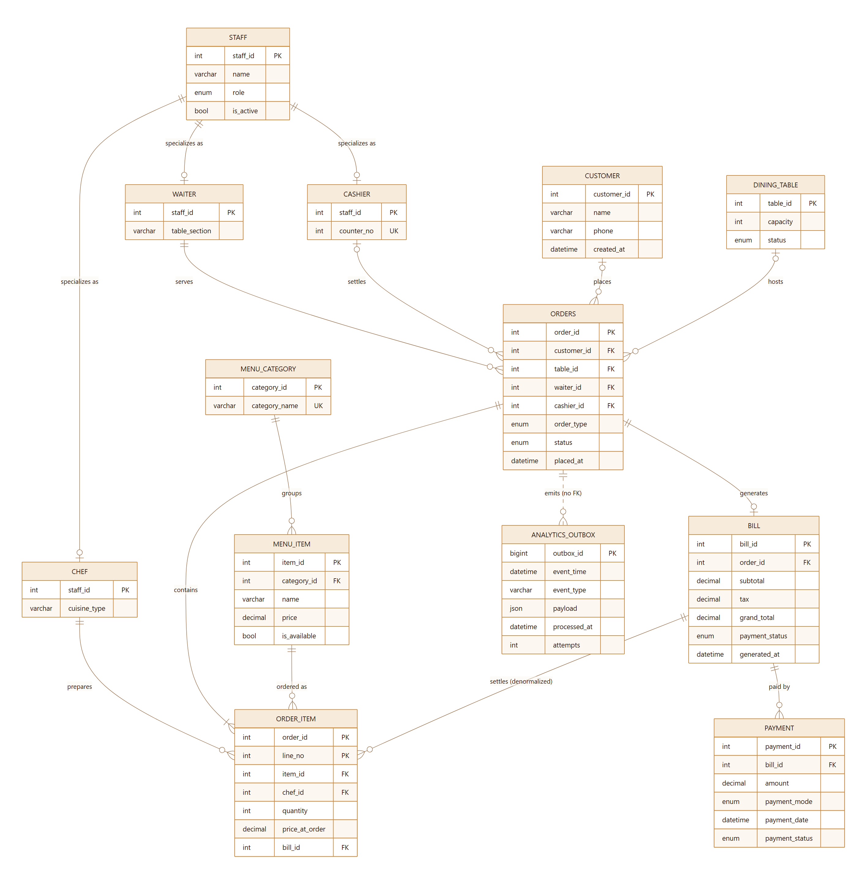
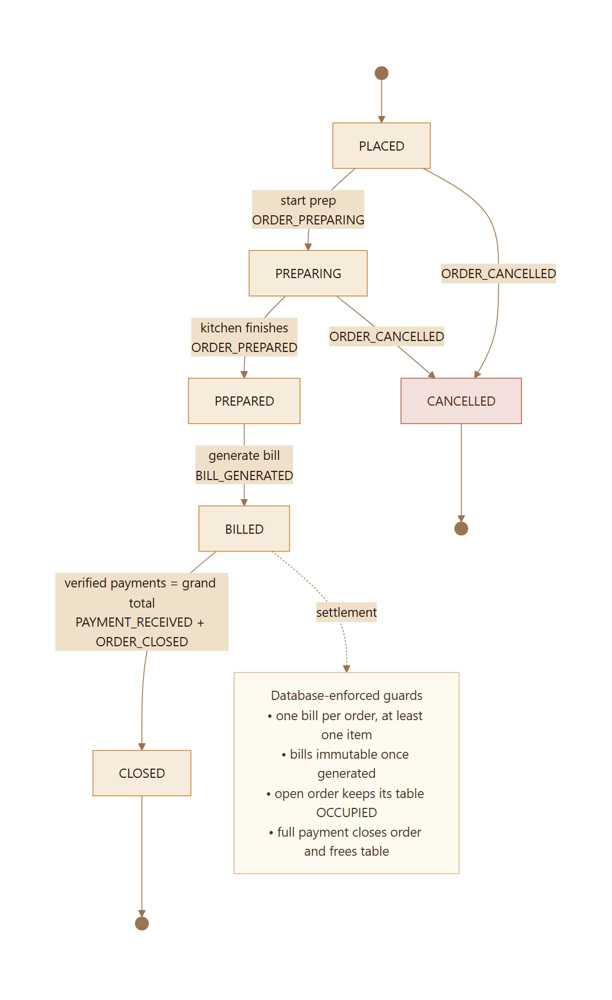

# Saffron House

## A Polyglot Restaurant Order & Billing System with MySQL and TimescaleDB

**DA3 — Database Systems Mini-Project Extension**  
React 18 · Flask 3 · MySQL 8.4 · TimescaleDB 2.31 / PostgreSQL 17

**Date:** 25 October 2026  
**Repository:** Saffron House DA3 (`README.md`, `docs/DEMO.md`)

---

## Abstract

Operational systems and analytical systems optimise for different things. A restaurant POS must enforce invariants, survive concurrent writers and settle money; a reporting layer must scan time-ordered facts quickly and summarise them cheaply. Saffron House demonstrates both workloads in one application. MySQL 8.4 remains the authoritative operational database, implemented as a normalised 13-table schema with a staff EER specialization, 14 foreign keys, three triggers, two stored procedures, a function and a reporting view. Every meaningful POS change also writes a JSON event to a transactional outbox in the same database transaction. A Python projector drains that outbox into a TimescaleDB hypertable using `FOR UPDATE SKIP LOCKED`, batched inserts and idempotent conflict handling. TimescaleDB maintains four continuous aggregates aligned to restaurant-local time, keeps recent buckets queryable in real time, compresses chunks older than 14 days and retains two years of history.

A React frontend provides the floor plan, POS, order tickets, billing counter, receipts, analytics workspace and read-only SQL Lab; Flask exposes the raw-SQL API. The deterministic seed contains 120 days of operations: 29,831 orders, 100,180 order lines and 283,634 events. Full-history revenue and successful collections reconcile exactly between both stores. In the 90-day benchmark, continuous aggregates answered daily revenue 5.38 times and hourly revenue 4.50 times faster than the MySQL baseline; the raw event store answered the top-items query 5.60 times faster. The report documents the design, schema, queries, verification and the limits of those measurements.

**Keywords:** polyglot persistence, transactional outbox, TimescaleDB, continuous aggregates, time-series databases, MySQL, restaurant POS, data reconciliation.

---

## Contents

1. Introduction
2. Technology selection
3. Requirements and system overview
4. System architecture
5. Data model
6. Database implementation
7. Sample data
8. Core operations and application behaviour
9. Technology-specific queries
10. Consistency, reconciliation and correctness
11. Performance evaluation
12. Verification, testing and demonstration
13. Limitations and future work
14. Conclusion
15. References
- Appendix A — API surface
- Appendix B — Reproduction commands
- Appendix C — SQL Lab catalogue

---

## 1. Introduction

### 1.1 Context

The previous phase of this mini-project (DA2) produced the conceptual and logical design of a Restaurant Order and Billing System: an ER model, a normalised relational schema and PL/SQL procedures for the core tasks. DA3 requires a working implementation that uses a modern database technology from outside the document-store space occupied by MongoDB, while retaining the stated React, Python, Flask and MySQL stack.

The extension was interpreted as an opportunity to build a genuinely polyglot system rather than to replace the operational schema with a trend-driven database. MySQL was recommended by the instructor and is well suited to the part of the problem that needs transactions and constraints. The analytical questions that a restaurant actually asks - revenue by hour, peak service windows, menu mix, kitchen percentiles, payment behaviour - have a different access pattern and a different data shape. TimescaleDB was added as the modern database for that workload.

### 1.2 Aim and objectives

The aim is a complete, demonstrable restaurant POS whose operational truth remains consistent while a time-series read model is maintained alongside it.

Specific objectives:

- Reimplement the DA2 design in MySQL 8.4, preserving its EER specialization, integrity rules and programmable objects.
- Design and implement a full POS workflow: floor state, order placement, kitchen progression, billing, split settlement, receipts and cancellation.
- Introduce TimescaleDB as a modern analytical store with a deliberate event schema rather than a copy of the OLTP tables.
- Connect the stores with a transactional outbox that does not require distributed transactions.
- Expose purpose-built analytical queries and a safe query workspace for inspection.
- Verify exact agreement between the stores, then measure and critically interpret performance.
- Deliver a report, diagrams, sample data, screenshots and a repeatable demonstration.

### 1.3 Scope

In scope: a single-restaurant service console, one currency (INR), one restaurant time zone (Asia/Kolkata), live POS writes, analytics over 7/30/90-day windows, a deterministic historical dataset, a read-only SQL Lab and a local benchmark.

Out of scope: authentication and role-based authorisation, multi-tenant isolation, refunds and voids, supplier/inventory management, online ordering integrations, horizontally scaled deployment, production backup and disaster recovery.

### 1.4 What was delivered

- A React SPA with 10 working surfaces plus a not-found view, covering operations, analytics and database inspection.
- A Flask API with raw SQL, pooling, validation, domain errors and two-database health reporting.
- Two schemas: a 13-table MySQL source of truth and a TimescaleDB event hypertable with four continuous aggregates.
- A deterministic 120-day generator that loads both stores and writes evidence files.
- A transactional outbox and projector, with manual and automatic sync.
- A 15-query SQL Lab, a live benchmark endpoint and a data-platform dashboard.
- Automated API tests, SQL integrity checks, reconciliation evidence and rendered diagrams.

---

## 2. Technology selection

### 2.1 Constraints

The brief required (a) a modern database technology other than MongoDB, (b) the React, Python, Flask and MySQL stack, and (c) an extension of the existing restaurant domain rather than an unrelated toy. The implementation also had to run locally, demonstrate realistic data volumes and remain explainable in a live viva.

### 2.2 Why one database is not the best fit

The two workloads have conflicting physical preferences:

| Property | Operational workload | Analytical workload |
| --- | --- | --- |
| Dominant operations | Point reads, inserts, updates, multi-row transactions | Large time-range scans, grouped aggregation |
| Data shape | Normalised to avoid update anomalies | Denormalised to avoid joins at read time |
| Freshness expectation | Immediate, strict | Seconds to minutes is usually acceptable |
| Indexes | Primary/foreign keys, selective lookup indexes | Time/type indexes, chunk pruning, columnar compression |
| Failure priority | Correctness of money and state | Availability of charts; can lag and catch up |
| Typical query | "Is this table free?" "What is the balance?" | "Revenue by hour for the last 90 days" |

Forcing both into one schema either burdens the operational database with large scans or deprives analytics of history-friendly physical design. A polyglot design keeps each store fit for purpose.

### 2.3 Selected design: MySQL + TimescaleDB

MySQL remains the **system of record**. It owns the ledger, order state, table state and every constraint that protects money. TimescaleDB is a **derived read model** for event-shaped analytics. It is never the authority for whether an order is open or what a bill says; it is a queryable history of facts that were already committed in MySQL.

The critical design decision is that the two stores are linked by a **transactional outbox** inside MySQL. A POS transaction writes its business rows and its analytics event rows atomically. A projector then copies the committed events into TimescaleDB. This avoids a distributed transaction between two engines, which would add two-phase commit complexity and a new failure mode for little benefit.

### 2.4 Why TimescaleDB

- **It is a PostgreSQL extension, not a separate query language.** The team already had relational SQL skills; PostgreSQL semantics, transactions, `FILTER`, window functions, CTEs and `percentile_cont` are available alongside time-series features.
- **Hypertables provide transparent time partitioning.** `order_event` is partitioned into 7-day chunks without changing application queries.
- **Continuous aggregates match the reporting workload.** Hourly rollups are incrementally refreshed and can serve recent, unmaterialised data in real time.
- **Compression and retention are declarative policies.** Older chunks are compressed automatically; history is bounded without application jobs.
- **It supports the comparison the report needs.** SQL Lab can run the same business question against the normalised MySQL model and the event store, making both the performance and the modelling trade-offs visible.

### 2.5 Alternatives considered

| Option | Strengths | Why it was not selected here |
| --- | --- | --- |
| Plain MySQL only | One engine, simple operations, strong transactions | Keeps analytical scans on the OLTP server; rollups and compression must be hand-built; less convincing as a modern-technology extension |
| PostgreSQL with manual partitioning | Full SQL, mature, no extra extension | Requires custom chunk management, rollup jobs, compression and retention; TimescaleDB packages those capabilities cleanly |
| InfluxDB | Purpose-built time-series ingestion and retention | Another query language and data model; relational joins, monetary semantics and ad-hoc SQL inspection are weaker for this use case |
| ClickHouse | Excellent large-scale OLAP performance | Operationally heavy for a laptop demo; duplicate/upsert semantics and transactional modelling are less natural for a small educational system |
| MongoDB time-series collections | Modern document store with time-series support | Excluded by the brief; documents would also duplicate a ledger whose core invariants are relational |
| Two-phase commit across stores | Strong atomic visibility | Operational complexity, coordinator failure modes and poor local reproducibility; an outbox achieves the required consistency with a simpler failure model |

### 2.6 Versions and deployment

| Component | Version | Role |
| --- | --- | --- |
| MySQL | 8.4.13 (InnoDB) | Operational source of truth, outbox |
| TimescaleDB | 2.31.0 | Hypertable, continuous aggregates, policies |
| PostgreSQL | 17.11 | SQL engine beneath TimescaleDB |
| Python / Flask | 3.12 / 3.1 | API, generator, projector |
| React / Vite | 18.3 / 5.4 | Single-page console |
| Docker Compose | Desktop, Linux containers | Reproducible database runtime |

The databases are exposed on non-default host ports (MySQL 3307, TimescaleDB 5433) to avoid collisions with locally installed servers. Flask listens on 5001 and Vite on 5173. Configuration is read from a gitignored `.env`; `.env.example` documents every key.

---

## 3. Requirements and system overview

### 3.1 Functional requirements

| ID | Requirement | Implementation |
| --- | --- | --- |
| FR1 | Manage a dining room and menu | 32 tables in four sections; 8 categories; 48 dishes; availability and category maintenance |
| FR2 | Place a dine-in, takeaway or delivery order | POS with table, waiter, guest, chef routing and multiple lines; prices snapshotted |
| FR3 | Enforce a valid order lifecycle | API transition map plus MySQL status constraints; only `PLACED/PREPARING` accept new lines |
| FR4 | Track kitchen progress | `ORDER_PREPARING` and `ORDER_PREPARED` events; preparation duration computed at transition |
| FR5 | Generate one bill per order | `generate_bill` procedure; unique `bill.order_id`; state and item checks |
| FR6 | Support split and partial settlement | Many payments per bill; trigger recomputes `UNPAID/PARTIAL/PAID` and closes on full payment |
| FR7 | Release tables automatically | Insert/update triggers synchronise `dining_table.status` with the order lifecycle |
| FR8 | Provide receipts and audit trail | Printable receipt, payment history, order timeline, outbox and event history |
| FR9 | Provide operational dashboards | Seven-day KPIs, revenue rhythm, top sellers, payment mix and cross-store reconciliation |
| FR10 | Provide time-series analytics | Revenue, menu/flow, kitchen, payments and platform tabs over 7/30/90 local days |
| FR11 | Provide safe database inspection | 15-preset SQL Lab across both engines; server-side read-only enforcement; 500-row cap |
| FR12 | Demonstrate performance and storage behaviour | Interleaved benchmark, compression stats, chunk inventory and CAGG inventory |

### 3.2 Non-functional requirements

| ID | Requirement | Evidence |
| --- | --- | --- |
| NFR1 | Operational writes must be atomic | Business rows and outbox rows share one InnoDB transaction; bills use stored routines |
| NFR2 | Analytics may lag but must converge | Outbox with retry metadata, idempotent projection and manual `/api/system/sync`; reconciliation at zero |
| NFR3 | Common reads must be fast and stable | Pooled connections, indexed queries, precomputed aggregates, bounded API pagination |
| NFR4 | The system must be reproducible | Dockerised versions, deterministic seed (`20261025`), scripted schema and seed |
| NFR5 | The interface must be usable on the demo laptop and a phone | Responsive layout verified at 1440 px and 390 px |
| NFR6 | Failures must be visible and explainable | `/api/health`, UI "Dual store live/Degraded" chip, outbox attempts/last_error, analytics 503 handling |
| NFR7 | Design choices must be defensible in a viva | Commentary in README/report, SQL Lab presets, honest benchmark caveats |

### 3.3 Actors and primary flow

The application models one internal actor, the **service team** (waiters, chefs and cashiers are specialised staff records). An analyst is the same operator using the analytics workspace. There is no end-customer-facing UI.

The primary flow is: seat or pick a table → build a ticket → send to kitchen → start prep → mark prepared → generate bill → take one or more payments → close and release the table → inspect the same facts analytically.

---

## 4. System architecture


*Figure 1. Runtime architecture. MySQL owns operational state and the outbox; the projector feeds a TimescaleDB hypertable; dashboards read continuous aggregates.*

### 4.1 Components

| Component | Responsibility | Key technology |
| --- | --- | --- |
| React SPA | Rendering, forms, client state, charts, toasts, routing | React 18, React Router, Recharts |
| Flask API | Validation, transactions, raw SQL, projection sync, error mapping | Flask 3, mysql-connector, psycopg 3 |
| MySQL | Authoritative ledger, lifecycle constraints, triggers/routines, outbox | InnoDB, MySQL 8.4 |
| Projector | Bounded batches of pending outbox rows, idempotent insert into analytics | Python, `FOR UPDATE SKIP LOCKED`, `ON CONFLICT` |
| TimescaleDB | Append-only event history, continuous aggregates, compression, retention | TimescaleDB 2.31 |
| Seed generator | Deterministic history for both stores and CSV evidence | Python `random.Random(20261025)` |
| SQL Lab | Curated read-only queries and editable SQL over both stores | Flask endpoint + React editor |
| Benchmark | Interleaved timing and revenue reconciliation | Python `perf_counter`, HTTP API |

### 4.2 Write path

1. The SPA posts a command to Flask (for example `POST /api/orders`).
2. Flask opens a MySQL transaction and validates the request against current state.
3. Business rows are written: `orders`, `order_item` (through `add_order_item`), `payment`, or `bill` (through `generate_bill`).
4. The service layer writes one or more `analytics_outbox` rows in the **same transaction**, with an event timestamp, type and JSON payload.
5. MySQL commits. Only after commit does Flask call the projector and return a response containing `sync` counts.
6. The projector locks a batch of unprocessed outbox rows with `FOR UPDATE SKIP LOCKED`, inserts them into `order_event` with `ON CONFLICT (source_outbox_id, event_time) DO NOTHING`, marks the outbox rows processed in MySQL, and repeats up to a bounded number of batches. After projecting, it refreshes the hourly buckets it touched in all four continuous aggregates, so the dashboard reconciles immediately after a live write.

Table occupancy is not computed in application code. The order triggers update `dining_table.status` inside the same MySQL transaction, so a crash cannot leave a table silently occupied or free without a corresponding order commit.

### 4.3 Read path

- Operational pages read MySQL directly through indexed joins: floor state, order tickets, bills and payments.
- The dashboard and analytics tabs read TimescaleDB continuous aggregates for historical buckets. The projector refreshes the current hour after each live batch, with TimescaleDB's real-time tail covering any events written before that refresh completes.
- Raw event scans (funnel, waiter leaderboard, compression audit) run against the hypertable.
- SQL Lab can query either engine but only through read-only statements.

### 4.4 Delivery semantics

The outbox provides **at-least-once delivery** rather than exactly-once execution:

- A crash after inserting into TimescaleDB but before marking the outbox row processed will cause a retry.
- The unique constraint `(source_outbox_id, event_time)` plus `ON CONFLICT DO NOTHING` makes retries idempotent.
- Batch ordering follows `outbox_id`, preserving commit order within a projector run.
- `FOR UPDATE SKIP LOCKED` allows more than one projector instance without duplicate work.
- Failures are isolated: a TimescaleDB outage records `attempts` and `last_error` in MySQL but never rolls back a POS commit. Events remain pending and can be replayed.

There is no background daemon in the demo: projection is invoked after each write and by `POST /api/system/sync`. This keeps the causal chain visible in a demonstration and avoids a hidden scheduler. In production the same function would run in a worker loop or scheduled job.

### 4.5 Why not two-phase commit?

A distributed transaction would require a coordinator that both MySQL and PostgreSQL trust, careful handling of in-doubt transactions and operational tooling that is disproportionate to an academic project. The outbox accepts temporary analytical lag in exchange for a simple invariant: if a business change committed, its event is durably queued; if the event was projected, it can be safely projected again.

### 4.6 Observability

`GET /api/health` reports both engines, their versions, counts, open orders, occupied tables and outbox status. The UI header turns the same information into a "Dual store live" or degraded state. The data-platform tab exposes chunk count, compression ratio, CAGG inventory, outbox health and database sizes live over the API. Errors are mapped to structured JSON: MySQL `SIGNAL` messages become HTTP 400, unique violations 409, lock conflicts 409 and analytics unavailability 503.

---

## 5. Data model

### 5.1 Operational model (MySQL)



*Figure 2. Logical ER model. Staff is specialised into waiter, chef and cashier by shared primary keys; dashed entities show the outbox feeding the analytical store.*

The operational schema has 13 tables and 14 foreign keys.

| Group | Table | Purpose and notable attributes |
| --- | --- | --- |
| Staff | `staff` | Shared identity: name, contact, `role`, active flag, contact-length check |
| Staff | `waiter` | Specialisation: `staff_id` PK/FK, `table_section` |
| Staff | `chef` | Specialisation: `staff_id` PK/FK, `cuisine_type` |
| Staff | `cashier` | Specialisation: `staff_id` PK/FK, unique `counter_no` |
| Dimensions | `customer` | Guest profile; unique email; optional phone |
| Dimensions | `dining_table` | 1-20 seats, `FREE/OCCUPIED` |
| Dimensions | `menu_category` | Unique category name |
| Dimensions | `menu_item` | Price, availability, vegetarian flag, category FK |
| Core | `orders` | Type, status, waiter, optional table/customer/cashier, lifecycle timestamps |
| Core | `bill` | One per order; subtotal, tax, discount, grand total, payment status |
| Core | `order_item` | Composite `(order_id, line_no)`; quantity, price snapshot, chef, denormalised `bill_id` |
| Core | `payment` | Many per bill; amount, mode, timestamp, `SUCCESS/FAILED/REFUNDED` |
| Integration | `analytics_outbox` | Event type, JSON payload, timestamps, attempts, last error |

### 5.2 Why the EER specialization is kept

Waiters, chefs and cashiers share identity and contact data but have different attributes and different foreign-key roles. Shared-primary-key specialisation preserves the "every waiter is a staff member" rule while preventing a chef from being assigned as a waiter through application convention alone. `orders.waiter_id` references `waiter(staff_id)`, `order_item.chef_id` references `chef(staff_id)`, and `orders.cashier_id` references `cashier(staff_id)`. The database, not the UI, enforces the role.

### 5.3 Constraints and invariants

- A dine-in order must have a table; takeaway and delivery orders must not.
- One bill per order is enforced by `UNIQUE (order_id)`.
- Quantities and payment amounts must be positive; a bill total cannot be negative.
- A bill requires at least one order line with a positive total (stored procedure).
- Only prepared orders can be billed; only unbilled, early-lifecycle orders can accept new lines or be cancelled.
- A successful payment cannot exceed the outstanding balance (API check under a locked bill row).
- A full successful payment closes the order and frees the table; a partial payment leaves both the order and the table open.
- Contact details must be at least ten characters; table capacity is bounded; a cashier counter is unique.

Indexes support the visible access paths: orders by `(status, placed_at)`, `table_id` and `placed_at`; bills by `generated_at`; order items by `bill_id` and `item_id`; payments by `(bill_id, payment_date)` and `payment_date`; outbox by `(processed_at, outbox_id)`.

### 5.4 The one deliberate denormalization

`order_item.bill_id` repeats a relationship that is already derivable through `orders`. It is retained from the DA2 design because it makes "which lines belong to this bill" a direct indexed lookup. The risk is a disagreement with `bill`. The implementation accepts the risk explicitly and audits it: SQL Lab's **Denormalization audit** counts billed lines whose `bill_id` is null or different from the bill generated for their order. It returns zero on the seeded data, and the bill procedure assigns the value in the same transaction that creates the bill.

### 5.5 Analytical model (TimescaleDB)

The analytics store is intentionally **not** a mirror of the normalised schema. It contains one wide event table:

| Column group | Columns | Notes |
| --- | --- | --- |
| Time/type | `event_id`, `event_time`, `event_type` | Hypertable partition key is `event_time`; event type is constrained |
| Order context | `order_id`, `order_type`, `table_id`, `customer_id` | Snapshot at event time |
| People | `waiter_id`, `waiter_name`, `chef_id`, `chef_name` | Names are captured so later renames do not rewrite history |
| Item snapshot | `item_id`, `item_name`, `category_name` | Enables menu analytics without cross-database joins |
| Money | `quantity`, `amount`, `payment_mode`, `bill_id`, `payment_id` | Amount semantics depend on event type |
| Kitchen | `prep_seconds` | Set on `ORDER_PREPARED` |
| Idempotency | `source_outbox_id` | With `event_time`, prevents duplicate projection |

A denormalised table would be a poor choice for the operational ledger: it would repeat mutable facts and make corrections expensive. It is the right choice for an append-only analytical history, where the question is "what was true when the event happened?" and where eliminating joins removes most of the query cost.

### 5.6 Physical design

- Hypertable `order_event`, created on `event_time`, chunk interval 7 days.
- Primary key `(event_id, event_time)` because the partition column must be part of the key.
- Unique `(source_outbox_id, event_time)` for idempotent projection.
- Six secondary indexes: `(event_type, event_time DESC)`, `(order_id, event_time DESC)`, `(item_id, event_time DESC)`, `(chef_id, event_time DESC)`, `(waiter_id, event_time DESC)` and `(bill_id, event_time DESC)`.
- 120 days of history produce 18 chunks; the newest 3 remain uncompressed for write performance.
- Compression is segmented by `event_type`, ordered by `event_time DESC`, and applied to chunks older than 14 days.
- Retention keeps 730 days of events.

### 5.7 Continuous aggregates

| Aggregate | Source events | Stored measures |
| --- | --- | --- |
| `sales_hourly` | `BILL_GENERATED` | bills, revenue, average bill, items billed |
| `order_activity_hourly` | `ORDER_PLACED` | orders placed |
| `payments_hourly` | `PAYMENT_RECEIVED` | payment count, amount collected |
| `kitchen_performance_hourly` | `ORDER_PREPARED` | orders prepared, average and maximum prep seconds |

All buckets use `time_bucket('1 hour', event_time, 'Asia/Kolkata')`, so a "day" in the UI is a restaurant-local day rather than a UTC day. Each aggregate has `timescaledb.materialized_only = false`, so recent unmaterialised data can be read from raw events; after each live batch, the projector also refreshes the touched hours so the same data is materialised for subsequent reads.

Refresh policies use a three-day start offset, a one-hour end offset and a 30-minute schedule. The offsets deliberately leave the current hour out of scheduled refreshes and avoid reprocessing excessively old history. To make live reconciliation exact, the projector refreshes the hours touched by each projected batch in all four views; the policies remain the periodic safety net. Daily charts are produced by rolling hourly buckets up; hourly granulation was chosen because it serves peak-hour analysis and can be aggregated further without loss.

### 5.8 Measure semantics

Consistency depends on making each measure mean one thing:

- **Revenue** is the sum of `amount` on `BILL_GENERATED` events. It is recognised when the bill is issued, not when cash arrives.
- **Collections** are the sum of `amount` on `PAYMENT_RECEIVED` events. Split payments produce one event per successful payment.
- **Bills** count `BILL_GENERATED` events; an order cannot have more than one.
- **Orders placed** count `ORDER_PLACED`; cancellations are reported separately and never become revenue.
- **Kitchen time** is elapsed seconds from `orders.placed_at` to the prepared transition, stored only on `ORDER_PREPARED`.

This is why the full-history billed revenue and collected payments differ by a small amount: unpaid balances on partial bills exist by design. It is also why "revenue" and "collections" are never mixed in one KPI without explanation.

---

## 6. Database implementation

### 6.1 Object inventory

| Type | Count | Objects |
| --- | ---: | --- |
| Tables | 13 | staff, waiter, chef, cashier, customer, dining_table, menu_category, menu_item, orders, bill, order_item, payment, analytics_outbox |
| Foreign keys | 14 | Staff specialisations, dimensions, order links, bill, items, payments |
| Triggers | 3 | `trg_orders_ai_status`, `trg_orders_au_status`, `trg_payment_ai_bill` |
| Stored procedures | 2 | `add_order_item`, `generate_bill` |
| Function | 1 | `calc_grand_total` |
| View | 1 | `DailySalesSummary` |
| Hypertables | 1 | `order_event` |
| Continuous aggregates | 4 | `sales_hourly`, `order_activity_hourly`, `payments_hourly`, `kitchen_performance_hourly` |
| Policies | 6 | 4 refresh, 1 compression, 1 retention |

### 6.2 Selected MySQL DDL

The staff specialisation uses shared primary keys and cascading deletes:

```sql
CREATE TABLE staff (
    staff_id  INT AUTO_INCREMENT PRIMARY KEY,
    name      VARCHAR(100) NOT NULL,
    contact   VARCHAR(20) NOT NULL,
    role      ENUM('WAITER','CHEF','CASHIER') NOT NULL,
    is_active BOOLEAN NOT NULL DEFAULT TRUE,
    CONSTRAINT chk_staff_contact CHECK (CHAR_LENGTH(contact) >= 10)
) ENGINE = InnoDB;

CREATE TABLE waiter (
    staff_id INT PRIMARY KEY,
    table_section VARCHAR(50) NOT NULL,
    CONSTRAINT fk_waiter_staff FOREIGN KEY (staff_id)
        REFERENCES staff (staff_id) ON DELETE CASCADE
) ENGINE = InnoDB;
```

Order lines preserve price history and carry the deliberate denormalisation:

```sql
CREATE TABLE order_item (
    order_id      INT NOT NULL,
    line_no       INT NOT NULL,
    item_id       INT NOT NULL,
    chef_id       INT NOT NULL,
    quantity      INT NOT NULL,
    price_at_order DECIMAL(10,2) NOT NULL,
    bill_id       INT NULL,
    PRIMARY KEY (order_id, line_no),
    CONSTRAINT chk_order_item_qty CHECK (quantity > 0),
    CONSTRAINT fk_oi_order FOREIGN KEY (order_id) REFERENCES orders(order_id) ON DELETE CASCADE,
    CONSTRAINT fk_oi_bill  FOREIGN KEY (bill_id)  REFERENCES bill(bill_id) ON DELETE SET NULL
) ENGINE = InnoDB;
```

The outbox is a normal InnoDB table, which is the point: it participates in the same transaction and recovery as the business rows.

```sql
CREATE TABLE analytics_outbox (
    outbox_id   BIGINT AUTO_INCREMENT PRIMARY KEY,
    event_time  DATETIME(6) NOT NULL,
    event_type  VARCHAR(40) NOT NULL,
    payload     JSON NOT NULL,
    created_at  DATETIME(6) NOT NULL DEFAULT CURRENT_TIMESTAMP(6),
    processed_at DATETIME(6) NULL,
    attempts    INT NOT NULL DEFAULT 0,
    last_error  VARCHAR(500) NULL,
    INDEX idx_outbox_pending (processed_at, outbox_id)
) ENGINE = InnoDB;
```

### 6.3 Triggers

| Trigger | Event | Behaviour |
| --- | --- | --- |
| `trg_orders_ai_status` | After order insert | Marks the table `OCCUPIED` when a new order has an active status and a table |
| `trg_orders_au_status` | After order update | Marks the table `FREE` on `CLOSED/CANCELLED`; otherwise keeps it `OCCUPIED` |
| `trg_payment_ai_bill` | After successful payment insert | Recomputes the bill's `UNPAID/PARTIAL/PAID` status; closes the order when the paid sum reaches the grand total |

The payment trigger is where settlement becomes an atomic database fact rather than a UI convention:

```sql
CREATE TRIGGER trg_payment_ai_bill
AFTER INSERT ON payment
FOR EACH ROW
BEGIN
    IF NEW.payment_status = 'SUCCESS' THEN
        SELECT COALESCE(SUM(amount), 0) INTO v_paid
          FROM payment
         WHERE bill_id = NEW.bill_id AND payment_status = 'SUCCESS';

        SELECT grand_total, order_id INTO v_total, v_order_id
          FROM bill WHERE bill_id = NEW.bill_id;

        UPDATE bill
           SET payment_status = CASE
                   WHEN v_paid >= v_total THEN 'PAID'
                   WHEN v_paid > 0 THEN 'PARTIAL'
                   ELSE 'UNPAID' END
         WHERE bill_id = NEW.bill_id;

        IF v_paid >= v_total THEN
            UPDATE orders
               SET status = 'CLOSED',
                   closed_at = COALESCE(closed_at, NEW.payment_date)
             WHERE order_id = v_order_id AND status <> 'CLOSED';
        END IF;
    END IF;
END
```

The trigger keeps the table status correct through `trg_orders_au_status`; the API then reads the new order state and emits `ORDER_CLOSED` in the same transaction. The business facts (bill paid, order closed) and the integration fact (event queued) still commit together.

### 6.4 Procedures, function and view

**`add_order_item`** validates that the order exists, is not billed, is `PLACED` or `PREPARING`, the quantity is positive, the chef and menu item exist, and the item is available. It computes the next line number and inserts the line inside the caller's transaction.

**`generate_bill`** validates the order and duplicate-bill condition, rejects closed/cancelled orders and empty orders, computes subtotal from snapshotted prices, applies tax and discount, inserts the bill, stamps `bill_id` on all order lines and moves the order to `BILLED`.

**`calc_grand_total`** returns `subtotal + tax - discount_amount` for a bill; it is used as a consistency check against the stored total.

**`DailySalesSummary`** is the relational baseline for the same daily revenue question:

```sql
CREATE OR REPLACE VIEW DailySalesSummary AS
SELECT DATE(generated_at) AS sale_date,
       COUNT(bill_id)     AS total_bills,
       SUM(grand_total)   AS total_revenue
  FROM bill
 GROUP BY DATE(generated_at);
```

### 6.5 Selected TimescaleDB DDL

The hypertable and its idempotency constraint:

```sql
CREATE TABLE order_event (
    event_id BIGSERIAL,
    event_time TIMESTAMPTZ NOT NULL,
    event_type TEXT NOT NULL,
    order_id BIGINT NOT NULL,
    ...
    source_outbox_id BIGINT,
    PRIMARY KEY (event_id, event_time),
    UNIQUE (source_outbox_id, event_time)
);

SELECT create_hypertable(
    'order_event', 'event_time',
    chunk_time_interval => INTERVAL '7 days',
    if_not_exists => TRUE
);
```

A continuous aggregate and its policy:

```sql
CREATE MATERIALIZED VIEW sales_hourly
WITH (timescaledb.continuous) AS
SELECT time_bucket('1 hour', event_time, 'Asia/Kolkata') AS bucket,
       COUNT(*) AS bills,
       SUM(amount) AS revenue,
       AVG(amount) AS avg_bill,
       SUM(quantity) AS items_billed
  FROM order_event
 WHERE event_type = 'BILL_GENERATED'
 GROUP BY bucket
WITH NO DATA;

ALTER MATERIALIZED VIEW sales_hourly
  SET (timescaledb.materialized_only = false);

SELECT add_continuous_aggregate_policy('sales_hourly',
    start_offset => INTERVAL '3 days',
    end_offset => INTERVAL '1 hour',
    schedule_interval => INTERVAL '30 minutes');
```

Lifecycle policies complete the physical design:

```sql
ALTER TABLE order_event SET (
    timescaledb.compress,
    timescaledb.compress_segmentby = 'event_type',
    timescaledb.compress_orderby = 'event_time DESC'
);
SELECT add_compression_policy('order_event', INTERVAL '14 days');
SELECT add_retention_policy('order_event', INTERVAL '730 days');
```

### 6.6 Database-specific SQL adaptations

The DA2 PL/SQL layer was not copied verbatim; it was redesigned for MySQL and PostgreSQL semantics.

| Concern | MySQL implementation | PostgreSQL / TimescaleDB implication |
| --- | --- | --- |
| Enumerated status | Native `ENUM` + `CHECK`s | Event type uses `TEXT` + `CHECK` instead |
| Raising business errors | `SIGNAL SQLSTATE '45000'`; API maps errno 1644 | Python raises/validates before SQL |
| Routine syntax | `DELIMITER`, `CALL proc(..., @out)` | Projection is plain parameterised SQL |
| JSON storage | Native `JSON` column | Not stored; event payload is validated on projection |
| Local time | `DATETIME` + session `+05:30` | `TIMESTAMPTZ`, buckets created with `Asia/Kolkata` |
| Idempotency | Outbox row `processed_at` | `ON CONFLICT (source_outbox_id, event_time) DO NOTHING` |
| Batch locking | `FOR UPDATE SKIP LOCKED` in MySQL | Plain inserts; conflicts ignored |
| Analytics-specific | `DATE()` view baseline | `time_bucket`, `FILTER`, `percentile_cont`, CAGGs |

### 6.7 Why stored routines still matter

The API could compute bills in Python, but the procedure centralises the financial rules inside the database where they cannot be bypassed by another client, and it is closer to the DA2 PL/SQL design. The procedure and the API are not redundant: the API validates user intent and maps errors; the procedure enforces invariants and writes the authoritative rows.

---

## 7. Sample data

### 7.1 Generator design

`backend/scripts/seed.py` is a deterministic Python generator. A fixed seed (`20261025`) drives every random choice: item popularity, party size, order timing, discounts, split payments and cancellations. The model includes:

- 32 tables, 8 categories and 48 dishes with prices from ₹50 to ₹520.
- 43 staff: 22 waiters, 15 chefs and 6 cashiers, each mapped to realistic sections or cuisines.
- 420 customer profiles plus walk-in guests.
- Lunch and dinner demand peaks, weekend uplift, seasonal item popularity and a cancellation rate near 1.2%.
- Price snapshots, 5% tax, occasional discounts, and split payments across cash, card, UPI and online.
- A deliberately open final state: 9 live orders on 9 occupied tables and 3 partial bills, so the dashboard has live material after a reseed.

### 7.2 Volumes

| Measure | Value |
| --- | ---: |
| History | 120 days |
| Orders | 29,831 |
| Order lines | 100,180 |
| Bills | 29,465 |
| Payments | 35,400 |
| Events | 283,634 |
| Customers | 420 |
| Menu items / categories | 48 / 8 |
| Staff | 43 |
| Tables | 32 |
| Open orders / occupied tables | 9 / 9 |
| Fully paid / partial bills | 29,462 / 3 |

Event distribution: 29,831 `ORDER_PLACED`, 100,180 `ITEM_ADDED`, 29,469 `ORDER_PREPARING`, 29,467 `ORDER_PREPARED`, 29,465 `BILL_GENERATED`, 35,400 `PAYMENT_RECEIVED`, 29,462 `ORDER_CLOSED` and 360 `ORDER_CANCELLED`.

Payments exceed bills because a single bill can be settled in multiple transactions. Billed orders exceed closed orders by three because three partial bills remain open. Prepared orders are fewer than placed orders because cancellations can occur before the kitchen finishes.

### 7.3 Load process

1. Generate the dataset in memory and stream a denormalised event CSV to `data/generated/order_events.csv`.
2. Write inspectable samples to `data/sample/` (orders, items, bills, payments, events, staff, tables, menu, customers).
3. Truncate and bulk-insert MySQL master and transactional tables, rebuild the floor state from open orders, and run `ANALYZE TABLE`.
4. Truncate `order_event` and load the CSV through PostgreSQL `COPY` for speed.
5. Refresh all four continuous aggregates over the full range.
6. Compress chunks older than 14 days.
7. Write `data/generated/seed_summary.json` with volumes, timings and compression results.

Observed timing on the reference laptop: 7.0 s generation, 18.2 s MySQL load, 5.9 s TimescaleDB load, 39.4 s total. On a rerun, the script truncates both data sets but does not drop the schemas.

### 7.4 Reproducibility and its limits

A fixed seed makes screenshots, benchmark windows and reconciliation figures repeatable. It does not make the data statistically representative of any real restaurant; demand patterns are hand-crafted. The generator is a test harness, not a forecasting model.

The historical dataset also bypasses the outbox: events are `COPY`-loaded directly because replaying 283k rows through the projector would add minutes of setup for no teaching value. Live writes, which are the behaviour being demonstrated, do use the outbox. The report and UI call this out explicitly rather than presenting seed storage as proof of streaming throughput.

---

## 8. Core operations and application behaviour



*Figure 3. Order state machine. Manual transitions are constrained in the API; billing and settlement transitions are enforced by the database and reflected as events.*

### 8.1 Operation-to-event mapping

| User action | Transactional work in MySQL | Event(s) emitted | Analytics effect |
| --- | --- | --- | --- |
| Send ticket | Insert `orders`; `CALL add_order_item` per line; table trigger marks occupied | `ORDER_PLACED`, one `ITEM_ADDED` per line | New order activity; line revenue and menu demand |
| Start prep | Update `orders` to `PREPARING` | `ORDER_PREPARING` | Order activity history |
| Mark prepared | Update `orders` to `PREPARED`, set `prepared_at`; compute prep seconds | `ORDER_PREPARED` with `prep_seconds` | Kitchen throughput and percentiles |
| Generate bill | `CALL generate_bill`; bill row, line stamps, status `BILLED` | `BILL_GENERATED` with grand total and item count | Sales revenue, bills, daily/hourly rollups |
| Record payment | Insert `payment`; trigger recomputes bill status; may close order and free table | `PAYMENT_RECEIVED`; `ORDER_CLOSED` if fully settled | Collections, payment mix, order closure |
| Cancel order | Update `orders` to `CANCELLED`, set `closed_at`; trigger frees table | `ORDER_CANCELLED` | Cancellation count; no revenue |

### 8.2 Order creation and concurrency

`POST /api/orders` locks the target table with `SELECT ... FOR UPDATE` and checks for an existing active order. This prevents two waiters from opening orders on the same table concurrently. It then inserts the order, invokes `add_order_item` for each line, reads the joined line context (item name, category, chef name, snapshotted price) and writes events. Table validation, item validation and event emission are in the same transaction.

For takeaway and delivery, `table_id` is forced to null. The schema check constraint enforces the same rule independently.

### 8.3 Billing and settlement

Only `PREPARED` orders can be billed. `generate_bill` computes the subtotal from `quantity * price_at_order`, applies the requested tax rate and discount, writes one bill, stamps every order line with `bill_id`, and changes the order to `BILLED`. The bill is immutable in normal operation: there is no update path, and a second bill is rejected by the unique constraint and API check.

Payment handling is deliberately allowed in multiple steps. Each payment is validated against the locked bill and current successful total; overpayment is rejected. The trigger then recomputes the status, so a partial payment yields `PARTIAL` and leaves the order `BILLED`, while a completing payment yields `PAID`, closes the order and frees the table. The API emits one collection event per successful payment, allowing the payment mix chart to reflect the actual settlement method.

### 8.4 Cancellation

Cancellation is allowed only before billing. A billed order must be refunded, not cancelled; the API rejects the transition. The route updates the status, frees the table through `trg_orders_au_status`, and emits `ORDER_CANCELLED`. Since revenue is recognised at billing, a cancelled pre-bill order never enters revenue, but it remains visible in the order funnel and cancellation count.

### 8.5 Application surface

| Page | Main content | Screenshot |
| --- | --- | --- |
| Dashboard | 7-day KPIs, live room, today's hourly revenue, top sellers, payment mix, reconciliation, event stream | `screenshots/01-dashboard.png` |
| Table floor | 32 tables, occupancy derived from open orders, seating flow | `screenshots/02-floor.png` |
| New order | Menu search/categories, ticket, table/waiter/guest/chef, send to kitchen | `screenshots/15-mobile-pos.png` |
| Orders / order detail | List and ticket with status actions, bill, timeline, service context | `screenshots/03-orders.png`, `screenshots/12-order-closed.png` |
| Billing / bill detail | Ledger, outstanding bills, printable receipt, split payments | `screenshots/04-billing.png`, `screenshots/13-receipt-paid.png` |
| Menu manager | Category/item inventory, availability, new item/category flows | `screenshots/05-menu.png` |
| Analytics | Revenue, menu & flow, kitchen, payments, data platform | `screenshots/06`–`10` |
| SQL Lab | 15 curated queries, editor, results and read-only guard | `screenshots/11-sql-lab.png` |
| Mobile | Responsive dashboard and POS at 390 px | `screenshots/14-mobile-dashboard.png`, `screenshots/15-mobile-pos.png` |

The API is grouped into six blueprints; the full route list is in Appendix A. Responses are JSON and errors have a stable shape. The frontend uses a small fetch wrapper with abortable polling, optimistic refresh and a toast system; it does not embed SQL or financial calculations.

---

## 9. Technology-specific queries

### 9.1 MySQL: relational baseline

MySQL answers the same business questions through normalised joins and its reporting view. The SQL Lab includes:

- **DailySalesSummary baseline** over `bill`, the direct comparison to the time-series daily revenue query.
- **Payment mode mix** over the operational payment ledger.
- **Waiter performance** through waiter → staff → orders → bill joins.
- **Outbox health** as an operational integration query.
- **Denormalization audit** for `order_item.bill_id`.

The waiter query demonstrates the join cost that the event store avoids:

```sql
SELECT s.name AS waiter,
       COUNT(DISTINCT o.order_id) AS orders,
       SUM(b.grand_total) AS revenue,
       ROUND(AVG(b.grand_total), 2) AS avg_bill
  FROM waiter w
  JOIN staff s ON s.staff_id = w.staff_id
  LEFT JOIN orders o ON o.waiter_id = w.staff_id
                    AND o.placed_at >= NOW() - INTERVAL 30 DAY
  LEFT JOIN bill b ON b.order_id = o.order_id
 GROUP BY w.staff_id, s.name
 ORDER BY revenue DESC;
```

### 9.2 TimescaleDB: gap filling and conditional aggregation

Quiet hours must appear as zero, not disappear. `time_bucket_gapfill` with `FILTER` produces a complete hourly axis:

```sql
SELECT time_bucket_gapfill('1 hour', event_time, 'Asia/Kolkata') AS bucket,
       COALESCE(SUM(amount) FILTER (WHERE event_type = 'BILL_GENERATED'), 0) AS revenue,
       COUNT(*) FILTER (WHERE event_type = 'BILL_GENERATED') AS bills
  FROM order_event
 WHERE event_time >= now() - INTERVAL '48 hours'
   AND event_time < now()
 GROUP BY bucket
 ORDER BY bucket;
```

This keeps the chart honest during closed hours and after a partial upload, without client-side padding.

### 9.3 Percentiles instead of misleading averages

Kitchen service is skewed by a few slow tickets. The panel reports median and p95 using PostgreSQL ordered-set aggregates:

```sql
SELECT time_bucket('1 day', event_time, 'Asia/Kolkata')::date AS day,
       COUNT(*)::int AS orders_prepared,
       ROUND(AVG(prep_seconds))::int AS avg_seconds,
       ROUND(percentile_cont(0.5) WITHIN GROUP (ORDER BY prep_seconds)::numeric)::int AS median_seconds,
       ROUND(percentile_cont(0.95) WITHIN GROUP (ORDER BY prep_seconds)::numeric)::int AS p95_seconds
  FROM order_event
 WHERE event_type = 'ORDER_PREPARED'
   AND prep_seconds IS NOT NULL
   AND event_time >= now() - INTERVAL '14 days'
 GROUP BY day
 ORDER BY day;
```

### 9.4 Pivoting a long payment stream

Conditional aggregation turns one row per payment into one row per day, ready for a stacked chart:

```sql
SELECT time_bucket('1 day', event_time, 'Asia/Kolkata')::date AS day,
       SUM(amount) FILTER (WHERE payment_mode = 'CASH')   AS cash,
       SUM(amount) FILTER (WHERE payment_mode = 'CARD')   AS card,
       SUM(amount) FILTER (WHERE payment_mode = 'UPI')    AS upi,
       SUM(amount) FILTER (WHERE payment_mode = 'ONLINE') AS online,
       SUM(amount) AS total
  FROM order_event
 WHERE event_type = 'PAYMENT_RECEIVED'
   AND event_time >= now() - INTERVAL '14 days'
 GROUP BY day
 ORDER BY day;
```

### 9.5 Funnel without hiding cancellations

```sql
SELECT
  COUNT(DISTINCT order_id) FILTER (WHERE event_type = 'ORDER_PLACED')::int AS placed,
  COUNT(DISTINCT order_id) FILTER (WHERE event_type = 'ORDER_PREPARED')::int AS prepared,
  COUNT(DISTINCT order_id) FILTER (WHERE event_type = 'BILL_GENERATED')::int AS billed,
  COUNT(DISTINCT order_id) FILTER (WHERE event_type = 'ORDER_CLOSED')::int AS closed,
  COUNT(DISTINCT order_id) FILTER (WHERE event_type = 'ORDER_CANCELLED')::int AS cancelled
FROM order_event
WHERE event_time >= now() - INTERVAL '30 days';
```

### 9.6 Continuous aggregates and raw scans

The dashboard's revenue and payment panels query `sales_hourly` and `payments_hourly`; they never scan 283k events for a 90-day chart. SQL Lab exposes the raw equivalents so the difference is inspectable. The compression audit joins `chunk_compression_stats('order_event')` to `timescaledb_information.chunks` to show both compressed and live chunks per week.

### 9.7 Query catalogue

There are 15 presets, 10 for TimescaleDB and 5 for MySQL:

| Database | Preset | Concept |
| --- | --- | --- |
| TimescaleDB | Revenue · hourly gap-filled | `time_bucket_gapfill` + `FILTER` |
| TimescaleDB | Daily revenue · 7-day rolling average | Window functions over buckets |
| TimescaleDB | Peak hours · weekday × hour heatmap | Local-time alignment |
| TimescaleDB | Top 10 menu items · revenue share | Denormalised dimensions + window share |
| TimescaleDB | Kitchen prep time · percentiles | `percentile_cont` |
| TimescaleDB | Payment mix · daily pivot | Aggregate `FILTER` |
| TimescaleDB | Order funnel · last 30 days | `COUNT(DISTINCT) FILTER` |
| TimescaleDB | Waiter leaderboard · revenue share | Snapshot dimensions + window |
| TimescaleDB | Compression audit · per chunk | Native compression statistics |
| TimescaleDB | Continuous aggregates · inventory | Timescale catalogue |
| MySQL | DailySalesSummary · operational view | Relational baseline |
| MySQL | Payment mode mix · 30 days | Operational ledger |
| MySQL | Waiter performance · joins | Five-table join |
| MySQL | Outbox projector · health | Transactional outbox |
| MySQL | Denormalization audit · bill_id | Intentional denormalization |

### 9.8 Read-only enforcement

SQL Lab accepts only a single `SELECT` or `WITH` statement. The server checks for a deny-list of write/administrative keywords, rejects multiple statements and applies a 500-row display limit. This is an application guard for a teaching tool, not a database security boundary; the API uses the same database credentials as the application. A production deployment would use read-only roles, separate credentials and query timeouts.

---

## 10. Consistency, reconciliation and correctness

### 10.1 What "correct" means here

Correctness has three layers:

1. **Operational invariants**: bills sum correctly; a paid bill corresponds to a closed order; a table has at most one active order; open orders keep tables occupied.
2. **Projection correctness**: every committed event is eventually present exactly once in `order_event`.
3. **Semantic correctness**: the same business question returns the same number from both stores when the question and window are defined identically.

### 10.2 Full-history reconciliation

| Fact | MySQL | TimescaleDB | Difference |
| --- | ---: | ---: | ---: |
| Billed revenue (all bills) | ₹38,421,396.00 | ₹38,421,396.00 (`BILL_GENERATED`) | ₹0.00 |
| Bills | 29,465 | 29,465 | 0 |
| Successful collections | ₹38,420,133.01 | ₹38,420,133.01 (`PAYMENT_RECEIVED`) | ₹0.00 |
| Payments | 35,400 | 35,400 | 0 |
| Orders placed | 29,831 | 29,831 | 0 |
| Orders prepared | 29,467 | 29,467 | 0 |
| Orders closed | 29,462 | 29,462 | 0 |
| Cancellations | 360 | 360 | 0 |

The difference between billed revenue and successful collections is **₹1,262.99**, the unpaid balance on three partial bills whose grand totals sum to ₹2,152.50. Revenue and collections are intentionally reported as separate measures.

### 10.3 Benchmark-window reconciliation

The 90-day benchmark window is defined in Asia/Kolkata calendar days and supplied to both stores as explicit bounds. Its dataset is 212,484 events and 22,085 bills. MySQL revenue and TimescaleDB revenue are both ₹28,783,764.50; the API reports an exact match with a ₹0.00 difference.

An earlier version aligned one store with `now() - 90 days` and the other with a calendar-day boundary, which produced a one-day/₹3,087 discrepancy. The fix was to compute the same explicit start and end for both queries in `backend/restaurant/benchmark.py`. This is a useful example of how easily a "performance benchmark" can compare different data.

### 10.4 Integrity checks

The verification pass reported zero rows for each of the following:

- bill total not equal to subtotal + tax - discount;
- bill marked paid whose successful payments are below the total;
- billed/closed order line with a missing or mismatched `bill_id`;
- orphan order items or payments;
- open order without a matching order row;
- occupied table without an active order;
- paid bill whose order is not closed;
- closed order without a paid bill.

`calc_grand_total(29462)` returned ₹1,648.50, matching the stored bill. The `DailySalesSummary` view and the event aggregate produced the same daily totals over all 120 common days.

### 10.5 Concurrency and retry reasoning

- Table allocation locks the table row, preventing double seating.
- Billing locks the order row and checks for an existing bill; the unique constraint is the final line of defence.
- Payment locks the bill and computes the outstanding balance inside the transaction; overpayment cannot race past the check.
- Status transitions read the current state with `FOR UPDATE` and reject illegal moves.
- The projector can run concurrently with POS writes because it only touches outbox rows that are unprocessed, and `SKIP LOCKED` avoids blocking.
- Re-projection after a crash is safe because of the unique `(source_outbox_id, event_time)` target key.

### 10.6 Honest failure modes

- If TimescaleDB is unavailable, the POS write still succeeds and events remain pending. The UI shows a sync failure; `/api/system/sync` retries.
- If a bug produced an event with an unknown type, the outbox insert would be accepted but projection would fail the event-type check. The error is recorded in `last_error`; no silent data loss occurs, but someone must act.
- If a payment is recorded directly in MySQL by an external client, the trigger updates bill/order state, but no outbox event is written. The application is the only supported event producer; database-level CDC would be needed to cover arbitrary clients.
- Outbox events are captured at write time. A subsequent manual edit to a bill or order item would not produce a compensating event, because the system deliberately does not expose such edits.

These limits are documented instead of being hidden behind the "event sourcing" label.

---

## 11. Performance evaluation

### 11.1 Environment

| Item | Value |
| --- | --- |
| Host | Windows 11 laptop, 13th Gen Intel Core i7-13620H |
| CPU/RAM | 16 logical CPUs, 15.6 GB RAM |
| Runtime | Docker Desktop, Linux containers; React/Flask running on the host |
| MySQL | 8.4.13, InnoDB, Docker Desktop defaults |
| TimescaleDB | 2.31.0 / PostgreSQL 17.11 |
| Data | 120 restaurant days; 283,634 events; 29,465 bills full history |
| Benchmark window | 90 restaurant days, 2026-07-28 00:00 to 2026-10-25 20:19 IST |
| Benchmark dataset | 212,484 events, 22,085 bills, ₹28,783,764.50 |

### 11.2 Method

The benchmark measures end-to-end query execution through the API for both stores, using the same connection pools and process. For each scenario:

1. Define identical Kolkata calendar-day bounds and pass them explicitly to both stores.
2. Run one warm-up query per store, excluded from statistics.
3. Take ten timed iterations per store per run, alternating the store order each round so host-load drift does not systematically favour either engine.
4. Repeat the whole process in three independent API runs, yielding **30 samples per store**.
5. Report the median (and p25-p75) rather than the mean, because a single scheduler hiccup produces long tails.
6. Reconcile the returned totals before accepting the timings.

The benchmark is triggered from the Data platform tab or `POST /api/analytics/benchmark`. The UI's interactive view is illustrative; the canonical figures below come from the three interleaved runs stored in `data/generated/benchmark-summary.json`.

### 11.3 Scenarios

| Scenario | MySQL query shape | TimescaleDB query shape |
| --- | --- | --- |
| 90-day daily revenue | Join/aggregate `bill` by date; 22k bills | Raw: filter 212,484 events by type and bucket. CAGG: read about 1,250 hourly rows from `sales_hourly` and roll up |
| 7-day hourly revenue | Aggregate bills by hour; 92 rows | Read `sales_hourly` for 168 hourly buckets; 92 non-empty rows |
| Top 10 menu items | Join `order_item` → `menu_item` → `menu_category` and aggregate 100k lines | Filter `ITEM_ADDED` events and group by snapshotted names |

### 11.4 Results

| Scenario | MySQL median (p25-p75) | Timescale raw median (p25-p75) | Timescale CAGG median (p25-p75) | Speed-up vs MySQL |
| --- | ---: | ---: | ---: | ---: |
| 90-day daily revenue | 30.00 ms (24.11-35.14) | 26.42 ms (22.34-36.13) | **5.58 ms** (4.19-6.89) | CAGG **5.38×**; raw 1.14× |
| 7-day hourly revenue | 19.35 ms (12.41-21.92) | — | **4.30 ms** (3.30-5.10) | CAGG **4.50×** |
| Top 10 menu items | 152.55 ms (146.52-185.89) | **27.25 ms** (25.19-29.52) | — | raw **5.60×** |

All scenarios returned the expected row counts (90, 92 and 10 respectively) and matched revenue where applicable.

### 11.5 Interpretation

**Daily revenue.** The continuous aggregate is 5.38× faster because it reads ~1,250 pre-aggregated hourly rows instead of scanning events or joining bills. This is the intended production path for dashboards.

**Raw daily revenue is only 1.14× faster than MySQL.** This is the most important honest result. MySQL is scanning ~22k indexed bill rows; TimescaleDB is scanning a deliberately wider 212k-event table containing line-level and payment events. Chunk pruning and columnar layout help, but the shapes are not equivalent. The event store is not magically faster because it is "modern"; it wins on the analytical workload when the data is organised for it.

**Hourly revenue.** The 4.5× CAGG advantage grows because the raw table would need finer filtering while the aggregate already matches the requested bucket. The store with precomputed hourly buckets also avoids a date-format conversion that the MySQL query performs per row.

**Top items.** The 5.6× raw advantage comes from modelling: the event stream already contains item and category names, while MySQL must join 100k order lines to menu dimensions. This is the clearest demonstration of denormalisation paying for itself on read-heavy analytics.

**Absolute times.** The browser-run screenshot in `screenshots/16-benchmark.png` is illustrative: interactive host load can inflate browser-side timings. The report quotes the interleaved API medians from `data/generated/benchmark-summary.json`, not the screenshot. Neither set is a production SLA; both are directional evidence from one laptop.

### 11.6 Storage and compression

| Measure | Value |
| --- | ---: |
| Hypertable size | ~31-32 MB |
| Chunks | 18 |
| Compressed chunks | 15 (all chunks older than 14 days) |
| Uncompressed size of those chunks | 125,976,576 bytes (~120.1 MiB) |
| Compressed size | 9,756,672 bytes (~9.3 MiB) |
| Compression ratio | 12.9× |
| Storage saved | 92.3% |
| Retention | 730 days |
| Refresh jobs | 4 policies, 30-minute schedule, 3-day lookback, 1-hour end offset |

The compression win is large because event columns repeat heavily (types, names, modes) and the segment/order configuration matches the compression layout. The newest chunks stay uncompressed so live writes remain cheap.

### 11.7 Threats to validity

- **Scale:** ~284k events is small. Cache effects and constant overhead dominate; results may change at tens of millions of rows.
- **Single host:** both engines share CPU, disk and Docker networking; host load affects both, and interleaving only reduces, not eliminates, bias.
- **Configuration:** neither engine is exhaustively tuned; buffer pools, PostgreSQL `shared_buffers`, MySQL settings and container resources are defaults suitable for a laptop.
- **Query authorship:** each query is written idiomatically for its engine, but small differences (date formatting, filter placement) can matter.
- **CAGG advantage is by design:** it is a materialised result, not a free lunch. Refresh cost and staleness are the trade-off and are not included in the read latency. The projector's post-drain refresh of the touched hours adds roughly 40 ms to a live write on the reference laptop; that cost is on the write path and is not part of the read benchmark.
- **Browser timings:** the UI measurement includes API and serialisation overhead, so it is not a pure database benchmark.

The claim supported by this evaluation is therefore narrow but useful: for the demonstrated reporting shapes, precomputed time-series aggregates substantially reduce read latency, and a denormalised event model can outperform a normalised multi-join baseline on raw analytical scans. It is not a claim that TimescaleDB always beats MySQL.

---

## 12. Verification, testing and demonstration

### 12.1 Automated tests

`backend/tests/test_api.py` exercises the running databases:

| Test | What it verifies |
| --- | --- |
| `test_health_reports_both_stores` | MySQL and TimescaleDB connectivity and status |
| `test_menu_and_dining_dimensions` | Menu/category data, table summary and waiter filtering |
| `test_sql_lab_blocks_writes` | `DELETE` is rejected; multiple statements are rejected |
| `test_dashboard_reconciles_both_stores` | Dashboard reconciliation is exact and outbox is drained |
| `test_full_order_billing_lifecycle` | Create → add lines → prepare → bill → partial payment → settlement → table release |

Result at the time of writing: **5 passed in 2.92 s**. The lifecycle test uses the live schema and settles the order it creates rather than deleting its audit trail.

### 12.2 Data verification

| Check | Result |
| --- | --- |
| Seed volumes | 29,831 orders / 100,180 items / 29,465 bills / 35,400 payments / 283,634 events |
| MySQL bill math mismatches | 0 |
| Bill/payment-status mismatches | 0 |
| Missing or mismatched item `bill_id` | 0 |
| Orphan items / payments | 0 |
| Open orders / occupied tables | 9 / 9 |
| Full-history revenue reconciliation | ₹38,421,396.00 vs ₹38,421,396.00, difference ₹0.00 |
| Full-history collections reconciliation | ₹38,420,133.01 vs ₹38,420,133.01, difference ₹0.00 |
| 90-day benchmark reconciliation | ₹28,783,764.50 vs ₹28,783,764.50, difference ₹0.00 |
| SQL Lab presets | 15 / 15 execute successfully |
| Production build | Vite build succeeds; only the expected chunk-size warning |

### 12.3 Interface evidence

| Evidence | Description |
| --- | --- |
| `screenshots/01-dashboard.png` | Dashboard with KPIs, live room, payment mix and zero-difference reconciliation |
| `screenshots/02-floor.png` | Floor plan with occupied/free tables |
| `screenshots/03-orders.png` | Operational order list |
| `screenshots/04-billing.png` | Billing ledger and outstanding bills |
| `screenshots/05-menu.png` | Menu manager |
| `screenshots/06`–`09` | Revenue, menu/flow, kitchen and payment analytics |
| `screenshots/10-analytics-system.png` | Storage, compression, chunks, CAGGs and outbox health |
| `screenshots/11-sql-lab.png` | Read-only SQL Lab with gap-filled query result |
| `screenshots/12-order-closed.png` | Captured order closed with split payments in its timeline |
| `screenshots/13-receipt-paid.png` | Captured receipt paid in full, with the table released |
| `screenshots/14-mobile-dashboard.png` | Responsive dashboard at 390 × 844 |
| `screenshots/15-mobile-pos.png` | Responsive POS at 390 × 844 |
| `screenshots/16-benchmark.png` | Benchmark panel (illustrative browser timings) |

The end-to-end evidence was captured from a real live flow: a ₹300 cash plus ₹277.50 UPI split payment, followed by the order closing and its table being freed. Screenshots are captured from the running application, not mockups.

### 12.4 Reproducing the demonstration

The detailed 10-minute script is in `docs/DEMO.md`. In short: start Docker, load both schemas, install the backend, run the seed, start Flask and Vite, place an order, advance it, bill it, split the payment, inspect analytics, run two or three SQL Lab presets, and finish on the benchmark panel. A clean reseed takes about 40 seconds.

---

## 13. Limitations and future work

### 13.1 Known limitations

1. **The seed bypasses the outbox.** Historical backfill uses `COPY`; only live traffic exercises projection. This is deliberate but must not be presented as proof of streaming throughput.
2. **At-least-once, not exactly-once.** Idempotence is achieved at the target, not in the transport. That is the right trade-off for this project but should be stated.
3. **Single-host, modest scale.** The benchmark is directional. It does not include millions of events, concurrent client load, contention, cache warm/cold separation or failure injection.
4. **No authentication or authorisation.** The console assumes a trusted internal user. SQL Lab is guarded by statement inspection, not database roles.
5. **No refunds/voids.** `payment.payment_status` supports `REFUNDED`, but there is no UI or compensating event flow. Reversal accounting is out of scope.
6. **Fixed locale and calendar.** INR and Asia/Kolkata are assumptions baked into the UI, generator and query defaults.
7. **No background projector.** Sync is called after writes and on demand. A real deployment would use a supervised worker with lag metrics and alerting.
8. **Limited editability.** Bills and paid orders are intentionally immutable; menu item edits do not back-propagate into historical events.
9. **Query guard is not a security sandbox.** A malicious user with API access is not the threat model. Read-only roles and resource limits would be required in production.
10. **No backup/HA plan.** Docker volumes make local data persistent, but there is no point-in-time recovery, replication or failover.

### 13.2 Future work

- Replace the request-triggered projector with a supervised worker, metrics, dead-letter handling and alerting on outbox age.
- Use CDC (for example Debezium) if external clients must write directly to MySQL and still produce events.
- Introduce Kafka or another durable log if multiple downstream consumers appear; the outbox remains the source contract.
- Add read-only database users, statement timeouts, per-user quotas and audit logging for SQL Lab.
- Support refunds, voids and corrections as compensating events, with a proper reversal model.
- Scale the benchmark to tens of millions of events, separate ingestion from query load, and test cold caches.
- Add authentication and role-based access (waiter, cashier, manager, analyst) if the scope expands.
- Tune PostgreSQL and MySQL configurations and report hardware-level metrics.
- Add automated reconciliation tests over every benchmark run, not only the lifecycle test.
- Consider monthly/daily continuous aggregates if historical daily charts grow beyond hourly scan efficiency.

---

## 14. Conclusion

Saffron House shows that a "modern database" extension does not have to mean replacing a sound relational core. MySQL remains the authoritative, constraint-rich operational database and carries the transactional outbox that makes the second store reliable. TimescaleDB contributes the time-series capabilities that would otherwise be hand-built: time partitioning, continuous aggregation, local-time bucketing, compression and retention.

The application is complete rather than illustrative: a ticket can be placed on a floor table, prepared, billed, split across two payment modes, closed and released; a receipt and an event history describe what happened; the same revenue is visible in MySQL and TimescaleDB with a zero-rupee difference. Fifteen queries make the modelling choices inspectable, and the benchmark reports both the impressive aggregate speed-up and the modest raw-scan result without hiding either.

The most transferable lesson is architectural rather than technological: choose each store for the shape of its workload, define what every measure means, make the integration boundary explicit, verify it with reconciliation, and state the limits of the evidence. The outbox plus continuous aggregates is a practical, explainable pattern for a small system, and the same reasoning scales to larger event-driven designs.

---

## 15. References

1. Elmasri, R. and Navathe, S. B. *Fundamentals of Database Systems*, 7th edition. Pearson, 2016. (EER modelling, normalisation, SQL and transaction concepts.)
2. Kleppmann, M. *Designing Data-Intensive Applications*. O'Reilly Media, 2017. (Polyglot persistence, event streams, derived data and idempotence.)
3. Oracle. *MySQL 8.4 Reference Manual* — https://dev.mysql.com/doc/refman/8.4/en/ (InnoDB, triggers, stored routines, `SIGNAL`, JSON, `SKIP LOCKED`.)
4. The PostgreSQL Global Development Group. *PostgreSQL 17 Documentation* — https://www.postgresql.org/docs/17/ (`FILTER`, ordered-set aggregates, CTEs, window functions.)
5. Timescale. *TimescaleDB Documentation* — https://docs.timescale.com/ (Hypertables, continuous aggregates, refresh/compression/retention policies.)
6. Microservices.io. *Pattern: Transactional Outbox* — https://microservices.io/patterns/data/transactional-outbox.html
7. React. *React Documentation* — https://react.dev/
8. Pallets. *Flask Documentation* — https://flask.palletsprojects.com/
9. Vite. *Vite Documentation* — https://vite.dev/
10. Docker. *Docker Compose Documentation* — https://docs.docker.com/compose/

---

## Appendix A — API surface

| Method and path | Purpose |
| --- | --- |
| `GET /api/health` | Store versions, counts, sync status |
| `POST /api/system/sync` | Drain pending outbox events |
| `GET /api/tables` | Floor state and summary |
| `GET /api/staff?role=&active=` | Staff filtered by specialisation |
| `GET /api/customers?q=&limit=` | Customer search |
| `POST /api/customers` | Create a guest |
| `GET /api/menu?category_id=&q=&available=` | Menu with categories |
| `GET /api/menu/specials` | Featured/available items |
| `POST /api/menu` | Add a menu item |
| `POST /api/menu/categories` | Add a category |
| `PATCH /api/menu/items/{item_id}` | Update price, availability or metadata |
| `GET /api/orders?scope=&status=&order_type=&limit=&offset=&q=` | Order list |
| `GET /api/orders/{order_id}` | Ticket, bill, items and timeline |
| `POST /api/orders` | Create an order and emit events |
| `POST /api/orders/{order_id}/items` | Add lines to an unbilled order |
| `POST /api/orders/{order_id}/status` | Start prep, mark prepared or cancel |
| `GET /api/bills?status=&order_id=&limit=&offset=` | Bill ledger |
| `GET /api/bills/outstanding` | Unsettled bills |
| `GET /api/bills/{bill_id}` | Receipt detail and payments |
| `POST /api/orders/{order_id}/bill` | Generate the bill |
| `POST /api/bills/{bill_id}/payments` | Record a cash/card/UPI/online payment |
| `GET /api/analytics/dashboard?days=` | Dashboard KPIs, reconciliation, live room |
| `GET /api/analytics/revenue-series?days=` | Daily/weekly revenue series |
| `GET /api/analytics/peak-hours?days=` | Weekday × hour heatmap |
| `GET /api/analytics/top-items?days=` | Menu leaders and shares |
| `GET /api/analytics/kitchen?days=` | Prep-time percentiles |
| `GET /api/analytics/payments?days=` | Payment mix and collections |
| `GET /api/analytics/order-flow?days=` | Funnel and lifecycle counts |
| `GET /api/analytics/storage` | Chunks, compression, CAGGs, outbox, table sizes |
| `GET /api/analytics/sql` | Query catalogue metadata |
| `POST /api/analytics/sql` | Run a read-only preset or custom query |
| `POST /api/analytics/benchmark` | Interleaved benchmark + reconciliation |

## Appendix B — Reproduction commands

```bash
# 1. Databases
docker compose up -d
docker compose ps

# 2. Schemas (Git Bash / WSL / macOS / Linux)
docker exec -i saffron-mysql mysql -urestaurant -prestaurantpass restaurant \
  < database/mysql/01_schema.sql
docker exec -i saffron-timescale psql -U restaurant -d restaurant_analytics \
  < database/timescale/01_schema.sql

# 3. Backend environment
python -m venv .venv
.venv/Scripts/python.exe -m pip install -r backend/requirements.txt

# 4. Deterministic seed (~40 s)
.venv/Scripts/python.exe backend/scripts/seed.py

# 5. Run API
.venv/Scripts/python.exe backend/app.py

# 6. Run frontend (second terminal)
cd frontend
npm install
npm run dev

# 7. Verify
curl http://127.0.0.1:5001/api/health
.venv/Scripts/python.exe -m pytest backend/tests -q
cd frontend && npm run build
```

PowerShell users can replace input redirection with `Get-Content -Raw <file> | docker exec -i <container> ...`.

## Appendix C — SQL Lab catalogue

TimescaleDB presets: hourly gap-filled revenue, 7-day rolling daily revenue, weekday × hour peak heatmap, top 10 items with revenue share, kitchen preparation percentiles, daily payment pivot, order funnel, waiter leaderboard, compression audit, continuous aggregate inventory.

MySQL presets: `DailySalesSummary` view baseline, payment mode mix, waiter performance joins, outbox projector health, intentional `bill_id` denormalization audit.

All presets are defined in `backend/restaurant/sql_catalog.py` and are available through the SQL Lab UI or `GET/POST /api/analytics/sql`.
